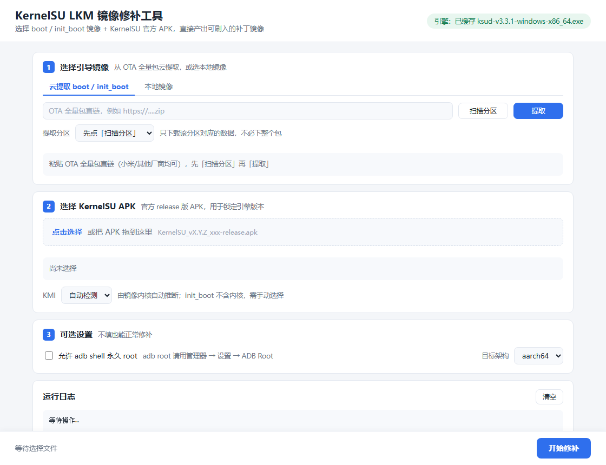
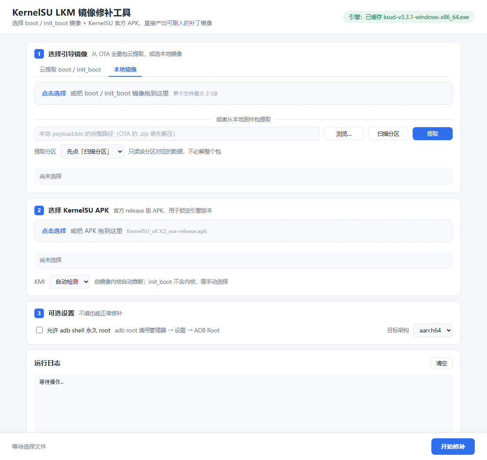

# KernelSU LKM 镜像修补工具（网页版）

在浏览器里给 Android 的 `boot` / `init_boot` / `vendor_boot` 镜像打 **KernelSU LKM 模式** 补丁，
产出可以直接 `fastboot flash` 刷入的镜像 —— 不用再靠手机上的 App 去修补。

```
从 OTA 全量包云提取 boot/init_boot（或选本地镜像） + 拖入 KernelSU 官方 APK
        →  点「开始修补」  →  下载 *-ksu-patched.img
```



---

## 一、启动

```bash
python web/server.py        # 或直接双击 run-web.bat
```

浏览器会自动打开 <http://127.0.0.1:8848>。然后：

1. **①引导镜像** —— 两个标签页，默认「云提取」：
   - **云提取**：粘贴 OTA 全量包直链 →「扫描分区」→ 选 `boot` / `init_boot` →「提取」。
     它只会下载该分区对应的数据，5.5 GB 的包提取 64 MB 的 boot 大约 8 秒。
   - **本地镜像**：拖入 `boot.img` / `init_boot.img`；或者在同一页下半部分选本地 `payload.bin` 提取。
   - 设备有 `init_boot` 分区就提 `init_boot`，没有就提 `boot`（扫描结果里会列出来）。
2. **②KernelSU APK** —— 官方 release 的 `KernelSU_vX.Y.Z_xxx-release.apk`
3. 看 **KMI** 是否自动填好（`init_boot` 不含内核，需手动选，见 FAQ）
4. 点 **开始修补**，完成后点「下载镜像」

常用启动参数：

| 参数 | 说明 |
|---|---|
| `--port 9000` | 换端口（默认 8848） |
| `--no-browser` | 不自动打开浏览器 |
| `--host 0.0.0.0 --allow-remote` | 对外提供服务（务必同时设密码） |
| `--password 你的密码` | 访问密码，浏览器弹一次登录框；对公网开放时**必须**设置 |

> 镜像**只在本机处理**：浏览器把文件传给本机的这个服务，再由本机的官方 `ksud` 引擎打补丁，
> 全程不出本机，也不会传给任何第三方。
>
> **产物直接存到桌面**：提取出的 `boot.img` / `init_boot.img` 和修补好的 `boot-ksu-patched.img`
> 都会自动复制到**当前登录用户的桌面**（用系统 API 解析，支持 OneDrive 接管桌面、任意用户名、多用户），
> 重名会自动加 `-1`、`-2`。日志里会打印完整路径。

---

## 二、它是怎么工作的

本项目 **不自己实现修补逻辑**，而是驱动 KernelSU 官方发布的 `ksud` 引擎
（Windows 用 `ksud-x86_64-pc-windows-gnu.exe`，Linux 用 `ksud-x86_64-unknown-linux-musl`，
每个 release 都会附带），所以产物与手机上「直接安装」得到的结果是**同一份代码**打出来的。

引擎在 ramdisk 里做的事情（对应 `userspace/ksud/src/boot_patch.rs`）：

| 步骤 | 操作 | 说明 |
|---|---|---|
| 1 | `init` → `init.real` | 保留原 init |
| 2 | 写入 `init`（`ksuinit`，0755） | 开机第一棒，负责加载模块 |
| 3 | 写入 `kernelsu.ko`（0755） | 与设备 KMI 匹配的内核模块 |
| 4 | 写入 `ksu_config`（可选） | `allow_shell=1` 等参数 |

开机时 `ksuinit` 先 `insmod /kernelsu.ko`，再把 `/init` 指回 `init.real`（或 `/system/bin/init`）并 exec，
之后才是正常的 Android 启动流程。

因为 `kernelsu.ko` 是**按 KMI（Android 版本 + 内核大版本）预编译**并内嵌在 `ksud` 里的，所以工具会：

1. 从 APK 读出 KernelSU 版本号（`app-metadata.properties` → `AndroidManifest.xml` → 文件名，逐级兜底）；
2. 下载 **同版本** 的官方 `ksud` 引擎并缓存到 `tools/ksud/`；
3. 从镜像内核里推断 KMI（`5.15.94-android13-…` → `android13-5.15`）；
4. 执行 `boot-patch`；
5. **回头校验产物**：自己解压 ramdisk（gzip / lz4 / xz / bzip2 / 裸 cpio）并解析 cpio，
   确认 `init`、`init.real`、`kernelsu.ko`、`ksu_config` 都真的写进去了，并把 `ksu_config` 的内容显示出来。

> 已用真实镜像验证：Android 12 / 内核 `5.10.168-android12`、`lz4_legacy` 压缩的 64 MB `boot.img`，
> 修补后 ramdisk 条目 20 → 23，新增 `init.real`、`kernelsu.ko`(379 KB)、`ksu_config`，
> `init` 被换成 603 KB 的 `ksuinit` —— 与官方 `lkm-aarch64-android12-5.10` 完全一致。

---

## 三、环境要求

- Python **3.9+**（推荐 3.10+），Windows / Linux 均可
- **不需要** `pip install`，也**不需要** tkinter
- 手机 **已解锁 bootloader**（LKM 模式必须刷 boot 分区）
- 首次修补需联网下载约 8 MB 的官方引擎（之后走缓存，可离线）
- 用「云提取」需要 `payload.exe`（放在项目根目录或 `tools/`）；只选本地镜像时不需要

---

## 四、云提取是怎么做的

两种提取方式都调用同目录下的第三方工具 `payload.exe`（`tools/` 或项目根目录，自动查找）：

```bash
# 云端（「云提取」标签页）：只取 payload.bin 里 boot 分区所需的块，不会下整包
payload.exe --url "https://.../miui_XXX_13.0.zip" boot --out <会话目录>

# 本地（「本地镜像」标签页）：从已解压的 payload.bin 提取
payload.exe "D://ota//payload.bin" boot init_boot --out <会话目录>
```

- 「云提取」只收 OTA 直链；本地 `payload.bin` 在「本地镜像」标签页下半部分选；
- 界面会先 `--list` 拿到分区表，按大小排序并默认选 `init_boot`（没有则 `boot`）；
- 提取过程实时显示进度和日志，产物直接落到会话目录，接着就能修补；
- 想换工具路径：放到 `tools/payload.exe` 即可（优先于根目录）。



---

## 五、刷入

镜像就在你的桌面上（日志里也会打印完整路径）。

```bash
# A/B 机型先确认槽位（可选）
fastboot getvar current-slot

# Android 13+（init_boot）
fastboot flash init_boot init_boot-ksu-patched.img

# Android 12 / 无 init_boot
fastboot flash boot boot-ksu-patched.img

fastboot reboot
```

> 刷之前先备份原镜像；要恢复原状，把原镜像重新 `fastboot flash` 回去即可。

关于 AVB：修补会改变 boot 内容，原 AVB 签名随即失效（预检里会提示「存在签名尾」）。
解锁 bootloader 后正常刷入即可；若机型开了 verity/verification 且刷完起不来，再补一条：

```bash
fastboot --disable-verity --disable-verification flash vbmeta vbmeta.img
```

（`vbmeta.img` 用你当前系统版本原包里的，别用别人的。）

---

## 六、支持范围与限制

- ✅ `boot` header **v3 / v4**（Android 12 起，内核 5.10+），以及 `init_boot`、`vendor_boot` v4
- ✅ ramdisk 压缩：gzip / lz4（frame 与 legacy）/ xz / lzma / bzip2 / 裸 cpio
- ❌ `boot` header v0~v2（Android 11 及更早）：上游引擎直接拒绝，LKM 模式本身也不支持
- ❌ 已被 **Magisk** 修补过的镜像（引擎会拒绝，避免互相破坏）
- ⚠️ 镜像必须与手机**当前系统版本一致**，否则可能开不了机
- ⚠️ 打补丁会让 AVB 校验失效，必须解锁 bootloader
- ⚠️ 工具只改镜像，**不负责刷入**，刷机风险由操作者承担

---

## 七、常见问题

**Q：勾了「允许 adb shell 永久 root」，为什么 `adb shell su` 还要去管理器授权？**
把那个已打补丁的镜像再拖进网页，信息区会显示：

```
状态：ramdisk 内已存在 kernelsu.ko（已打过补丁）
ksu_config = 'allow_shell=1 bundled=1'
→ allow_shell 已开启：adb shell 的 su 由内核直接放行
```

只有看到 `allow_shell=1` 才算真写进去了。原理：它是**内核模块参数**，
`kernel/policy/allowlist.c` 里对 `uid == 2000 (shell)` 直接放行、连授权框都不会弹。
如果镜像里确实有却仍然要授权，说明模块没带着这个参数加载 —— 基本是刷了旧镜像、刷错槽位，或刷完没重启。

**Q：「强制开启 adb root」为什么完全没用？**
它在 KernelSU v3.x 里是**死参数**：`boot_patch` 只是往 ramdisk 写 `/force_debuggable` 和 `/adb_debug.prop`，
整个仓库没有任何代码读它们（`grep -r force_debuggable` 只有写入和删除）。
真正的 adb root 是：管理器 → 设置 → **ADB Root**（= `ksud feature set adb_root 1`，
由 `magica.rs` 用 resetprop 改 `ro.debuggable` 再重启 adbd）。所以界面上只留了一行提示，不做假开关。

**Q：`init_boot.img` 为什么不能自动识别 KMI？**
`init_boot` 里只有 ramdisk、没有内核，读不到内核版本串。手动选即可，规则是「Android 大版本 + 内核大版本」：

| 内核版本 | Android | 应选 KMI |
|---|---|---|
| 5.10.x | 12 | `android12-5.10` |
| 5.10.x | 13 | `android13-5.10` |
| 5.15.x | 13 | `android13-5.15` |
| 5.15.x | 14 | `android14-5.15` |
| 6.1.x | 14 | `android14-6.1` |
| 6.6.x | 15 | `android15-6.6` |

手机上「设置 → 关于手机 → 内核版本」能看内核号；装了 KernelSU App 的话安装页会直接显示当前 KMI。

**Q：为什么一定要选 APK，不能只选版本？**
`ksud` 内嵌的 `kernelsu.ko` 和 `ksuinit` 是跟着版本走的，必须和 APK 同版本，
否则会出现「App 与内核模块版本不匹配」。所以用 APK 锁定版本，再去下同版本引擎。

**Q：云提取报「没有找到 payload.exe」？**
把 `payload.exe` 放到项目根目录或 `tools/` 下，重启服务即可（界面上「引擎」位置会显示是否找到）。

**Q：文件到底存在哪？会不会传到网上？**
不会联网。所有文件都在你本机：
- 中间文件在 `web/work/<会话ID>/`（服务启动时自动清理 12 小时前的）；
- **最终产物会复制到当前用户桌面**，路径在日志里（`[OK] 已保存到桌面：...`）；
- 网页上的「下载镜像」只是再复制一份到你浏览器的下载目录，可有可无。

**Q：桌面路径是怎么找到的？**
优先 `SHGetKnownFolderPath(FOLDERID_Desktop)`，其次读注册表 `User Shell Folders\Desktop`，
最后按 `~/Desktop`、`~/OneDrive/Desktop`、`~/桌面` 兜底。所以换用户、桌面被 OneDrive 接管都不会存错地方。

**Q：本地 payload.bin 怎么用？**
切到「本地镜像」标签页，下半部分点「浏览…」选 `payload.bin`（OTA 的 `.zip` 请先解压），
再「扫描分区」→「提取」。文件不会被上传，后端直接用路径读。

**Q：云提取一直卡在「正在读取包信息」？**
云端要先读 zip 里的 `payload_metadata.bin`，如果链接需要跳转/鉴权或速度很慢就会卡住。
可以先把包下载到本地，解压出 `payload.bin`，再用「浏览…」选本地文件提取。

**Q：首次修补下载引擎失败怎么办？**
1. 再点一次「开始修补」（会自动切换加速镜像重试）；
2. 手动下载 `ksud-x86_64-pc-windows-gnu.exe`，放到 `tools/ksud.exe`，重启服务即可；
3. Linux 上则放 `ksud-x86_64-unknown-linux-musl` 并 `chmod +x`。

**Q：提示「KMI xxx 不在该 APK 内置列表中」？**
说明这版 APK 没内置该 KMI 的模块。换更新的 APK / 引擎。

**Q：报 `bootimage version N is not supported!`**
镜像是 v0~v2（Android 11 及更早），LKM 模式不支持。

**Q：刷完卡开机动画 / 无法开机？**
重新进 fastboot，把备份的原镜像刷回去即可恢复。

**Q：能部署到公网 / 绑定自己的域名吗？**
能。有三种方案，按你的场景选：

| 方案 | 适用场景 | 文档 |
|---|---|---|
| **Cloudflare Tunnel** | 家里电脑，没有公网 IP | [docs/deploy-cloudflare.md](docs/deploy-cloudflare.md) |
| **VPS / 云服务器** | 买了服务器，想 24 小时在线 | [docs/deploy-vps.md](docs/deploy-vps.md) |

**VPS 注意**：Linux 服务器**不能**跑 `payload.exe`（没有 Linux 版），所以「OTA 云提取」功能不可用；上传本地 `boot.img` / `init_boot.img` 打补丁完全正常。

不管哪种方式，请务必：

1. 启动时加 `--password 强密码`（否则任何人都能往你服务器上传镜像并触发修补）；
2. 再套一层 Cloudflare Access（邮箱验证码）或 nginx basic auth，双保险；
3. Cloudflare 代理有 **100MB 请求体上限**，超过的镜像请改用「云提取」（Tunnel 方案）或直接上传（VPS 方案无此限制）。

---

## 八、目录结构

```
.
├── run-web.bat              Windows 双击启动网页版
├── requirements.txt        仅标准库，无需 pip install
├── web/
│   ├── server.py            后端：标准库 http.server，零依赖
│   ├── static/              前端：原生 HTML/CSS/JS（拖拽上传 + 日志轮询）
│   └── work/                运行时上传与产物（自动创建，可随时删）
├── ksulkm/
│   ├── bootimg.py           boot/init_boot/vendor_boot 头解析、KMI 推断、压缩识别、cpio 解析、AVB/已打补丁检测
│   ├── lz4.py               纯 Python LZ4 解码（frame / legacy / block）
│   ├── apk.py               APK 版本号（含二进制 AndroidManifest.xml 解析）、ABI、内置 KMI 列表
│   ├── downloader.py        按版本下载/缓存官方 ksud 引擎（跨平台 + 多镜像加速）
│   ├── engine.py            探测引擎、拼装 boot-patch 命令、流式执行
│   ├── patcher.py           流程编排：预检 → KMI → 引擎 → 修补 → 产物校验
│   ├── payload_tool.py      调用 payload.exe 扫描/提取分区（云端 & 本地）
│   └── util.py              杂项
├── tests/selftest.py        自检（合成镜像 + 合成 APK，无需真机/联网）
├── payload.exe              OTA 提取工具（云提取用，自带）
├── tools/ksud/              引擎缓存（首次自动下载）
└── docs/                    界面截图（web.png / web-local.png）
```

## 九、自检

```bash
python tests/selftest.py
```

用**合成数据**验证 66 项：boot v0/v3/v4、init_boot、vendor_boot v4 的解析、KMI 推断、压缩内核、
已打补丁检测、`ksu_config` 读取、cpio 条目解析、LZ4（frame/legacy）解码、二进制 XML 解析、
APK 版本三条兜底路径、命令拼装，以及编排流程的成功 / 缺 KMI / 不支持镜像等分支。

---

## 仓库卫生

下面这些**不要提交进 Git**（`.gitignore` 已挡）：

| 文件 | 原因 |
|---|---|
| `boot.img` / `*.img` | 厂商固件，体积大（64~96MB）且涉及分发授权 |
| `payload.exe` | 第三方工具（作者"起汐顺子"），请自行确认授权再分发 |
| `*.apk` | 下载来的 KernelSU 安装包，没必要进仓库 |
| `tools/ksud/*.exe` | 运行时自动下载的引擎缓存 |

如果已经推上去了，从仓库移除但保留本地文件：

```bash
git rm --cached payload.exe KernelSU_v3.3.1_32680-release.apk
git rm --cached boot.img            # 如果推过
git commit -m "chore: 移除大文件与第三方二进制"
git push
```

（想保留历史就去 GitHub 设置里开 Git LFS，但一般没必要。）

---

## 免责声明

本项目只是官方 `ksud` 的网页外壳，遵循 KernelSU 项目（GPL-3.0）的开源成果。
刷机有风险，操作前请务必备份原镜像并确认机型/系统版本，因使用本工具造成的任何后果由使用者自行承担。
